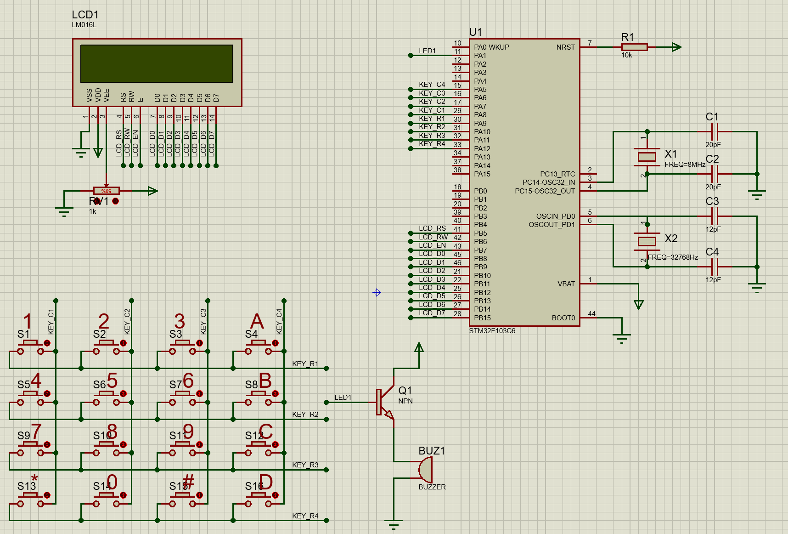

# STM32 单片机密码锁

基于 **STM32F103C6 + LCD1602 + 4×4 矩阵键盘 + 蜂鸣器** 的电子密码锁，配套 **Proteus 8.17** 仿真工程。

## 主要功能

- 六位数字密码输入，LCD 使用星号隐藏输入。
- 默认密码为 `123456`，支持验证旧密码后设置新密码，并重复输入确认。
- 支持退格、清空和取消操作。
- 连续三次完整密码验证错误后报警 30 秒，期间屏蔽按键。
- 开锁状态显示 3 秒后自动返回锁定，也可提前上锁。

## 文件入口

| 文件或目录 | 说明 |
| --- | --- |
| `仿真/STM32F103C6.pdsprj` | Proteus 仿真工程 |
| `仿真/密码锁.hex` | 配套仿真程序 |
| `代码/MDK-ARM/STM32F103C6.uvprojx` | Keil MDK 工程 |
| `代码/Src/password_lock.c` | 密码锁状态机与业务逻辑 |
| `代码/Src/key4x4.c` | 矩阵键盘扫描 |
| `代码/Src/lcd1602.c` | LCD1602 显示驱动 |
| `代码/Src/buzzer.c` | 蜂鸣器控制 |
| `代码/Drivers/` | CMSIS 和 STM32 HAL 驱动，保留随附许可文件 |
| `使用说明.txt` | 完整操作、接线、验收步骤和验证范围 |
| `download.png` | 随附操作速览图片 |
| `schematic.png` | 电路图封面 |

原项目中的已有编译输出及工程备份按原样保留；此分支未加入视频。

## 使用步骤

1. 使用 Proteus 8.17 打开 `仿真/STM32F103C6.pdsprj`。
2. 双击 U1，将 Program File 指向 `仿真/密码锁.hex`；复制工程后如路径失效，请重新选择文件。
3. 启动仿真，LCD 主菜单应显示 `LOCKED A:OPEN` 和 `B:CHANGE PWD`。
4. 正常开锁：`A → 123456 → D`。
5. 修改密码：`B → 当前密码 → D → 六位新密码 → D → 再次输入新密码 → D`。

## 按键

| 按键 | 操作 |
| --- | --- |
| 0～9 | 输入六位数字，支持前导零 |
| A | 从主菜单进入开锁 |
| B | 从主菜单进入密码修改，先验证当前密码 |
| C | 删除正在输入的最后一位 |
| D | 确认；开锁时可提前上锁 |
| * | 取消返回主菜单；开锁时可提前上锁 |
| # | 清空当前输入 |

每次按键后松开再按下一键。位数不足六位不计为密码错误；开锁与修改密码的旧密码验证共用连续错误计数。

## 主要接线

- 蜂鸣器：PA1，高电平响，低电平静音，网络标签为 `LED1`。
- 键盘 C1/C2/C3/C4：PA8/PA7/PA6/PA5。
- 键盘 R1/R2/R3/R4：PA9/PA10/PA11/PA12。
- LCD RS/RW/EN：PB5/PB6/PB7；D0～D7：PB8～PB15。

## 编译与验证范围

Keil 工程为 `代码/MDK-ARM/STM32F103C6.uvprojx`。重新编译输出位于 `代码/MDK-ARM/DEMO/DEMO.hex`，需复制为 `仿真/密码锁.hex` 后加载。

根据随附使用说明，项目已完成 Keil 编译和 ARM 逻辑仿真；**尚未实际运行 Proteus 电路或烧录实物**。本次整理上传没有额外进行编译或动态仿真，蜂鸣器、LCD 对比度及电路时序需按使用说明实际验收。

当前密码保存在 RAM 中，停止并重新运行仿真、断电或复位后恢复为 `123456`。此版本没有密码掉电保存功能。电路未包含电锁或继电器，开锁通过 LCD 状态表示。

[返回 Proteus 项目总目录](https://github.com/wangxin-ux/proteus)
