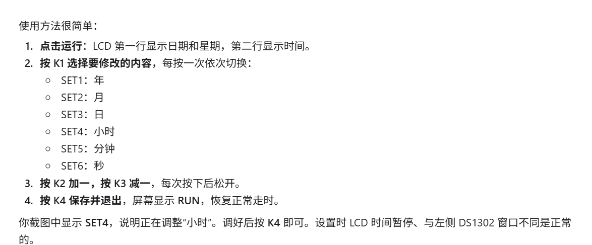

# 51 单片机万年历

基于 **AT89C51 + DS1302 + LCD1602** 的万年历项目，包含 Proteus 电路、C51 源码、Keil 工程、预编译 HEX和使用说明。

## 功能

- 显示 2000～2099 年公历日期、星期、时分秒。
- 自动处理闰年与大小月。
- K1 依次选择年、月、日、时、分、秒；K2 加一，K3 减一；K4 保存并退出设置。
- LCD 仅更新变化字符，减少闪烁。

## 文件

| 路径 | 内容 |
| --- | --- |
| `代码/main.c` | C51 源码 |
| `代码/万年历.uvproj` | Keil uVision 工程 |
| `代码/STARTUP.A51` | 8051 启动文件 |
| `代码/calendar.hex` | 预编译程序 |
| `仿真/wannianli.DSN`、`仿真/wannianli.pdsprj` | Proteus 电路与工程 |
| `仿真/calendar.hex` | 仿真加载程序 |
| `使用说明.txt` | 详细使用说明与验证范围 |

## 打开仿真

1. 使用 Proteus 打开 `仿真/wannianli.DSN` 或对应的 `.pdsprj` 工程。
2. 双击 U1，将 Program File 设置为本仓库内的 `仿真/calendar.hex`。
3. 将 U1 时钟频率设为 **12 MHz**；DS1302 外部晶振为 **32.768 kHz**。
4. 启动仿真，按 K1～K4 操作日期时间设置。

## 编译与验证范围

使用 Keil C51（8051）工具链打开 `代码/万年历.uvproj`。编译后的 HEX 路径为 `代码/Objects/calendar.hex`，需复制至仿真目录再加载。

根据项目随附说明：当前 C51 源码尚未经过 Keil C51 实际编译；随附 HEX 来自同等逻辑的兼容转换版，经 SDCC 编译生成。已有工程引用、引脚、HEX 一致性、校验和及 4 KB 地址范围的静态检查，**尚未进行 Proteus 动态复测**。

## 电路来源

电路来源：[HangYongmao/51_Proteus_Demo_230](https://github.com/HangYongmao/51_Proteus_Demo_230)，源码按本电路适配。完整说明见 `使用说明.txt`。本次整理保留原文件，未额外授予第三方素材的许可。
